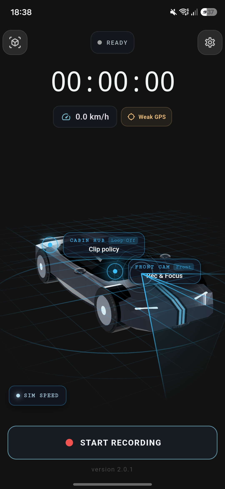

# Dashcam

[](https://github.com/Starry03/dashcam/releases) [](LICENSE) [](https://github.com/Starry03/dashcam/commits) [](https://github.com/Starry03/dashcam/issues) [](https://github.com/Starry03/dashcam/stargazers)

Dashcam is a Flutter (Kotlin/CameraX) app that turns your phone into a practical in-car dashcam with foreground recording, loop management, and quick controls.

<p align="center">
  
</p>


## Notes

Do you want an
- overengineered
- vibecoded
- only android

dashcam application?

### Advantages
- you have a free dashcam
- background recording (no need to keep you camera running which can distract you)
- autofocus (so you don't record your car but the others)

## Download

Available for android

[Download latest release](https://github.com/Starry03/dashcam/releases/latest)

## Local development

### Requirements

- Flutter SDK
- Android SDK / Android Studio
- Physical Android device recommended for camera and GPS testing

### Run in debug

```bash
git clone https://github.com/Starry03/dashcam.git
cd dashcam/app
flutter pub get
flutter run
```

### Build APK

```bash
cd app
flutter pub get
flutter build apk
```

## Roadmap

- iOS parity
